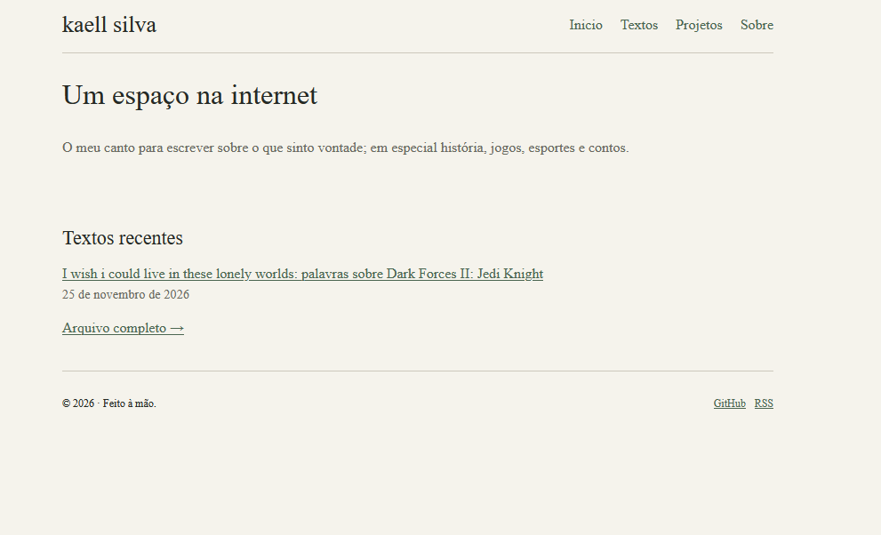

# kaell-blog

Blog pessoal Full Stack desenvolvido com HTML, CSS, JavaScript,
Node.js, Express e PostgreSQL.

O projeto possui um sistema de gerenciamento de publicações
com autenticação administrativa, permitindo criar, consultar,
editar e excluir artigos sem modificar diretamente os arquivos HTML.

## Acesse o projeto

🌐 **Blog online:** https://kaell-blog.onrender.com/

## Tecnologias utilizadas

- HTML5 e CSS3
- JavaScript
- Node.js e Express
- PostgreSQL
- Neon — banco de dados na nuvem
- Render — hospedagem
- Git e GitHub

## Arquitetura da aplicação

O projeto utiliza uma arquitetura Full Stack com frontend
em JavaScript, API REST desenvolvida em Express e banco
de dados PostgreSQL.

### Fluxo de funcionamento

1. O visitante acessa o blog pelo navegador.
2. O Express, hospedado na Render, disponibiliza as páginas.
3. O frontend utiliza `fetch()` para consultar a API.
4. A API realiza consultas SQL ao PostgreSQL hospedado no Neon.
5. Os dados são retornados em JSON e exibidos na interface.

### Organização dos arquivos

- `index.html` — página inicial com artigos recentes.
- `textos.html` — listagem completa das publicações.
- `artigo.html` — página individual dos artigos.
- `gerenciador.html` — interface administrativa.
- `login.html` — autenticação do administrador.
- `js/` — lógica do frontend e comunicação com a API.
- `css/` — estilos visuais.
- `backend/server.js` — servidor Express e rotas da API.
- `backend/db.js` — configuração da conexão com PostgreSQL.
- `backend/schema.sql` — estrutura das tabelas.

### Ambientes

**Desenvolvimento:** Node.js e PostgreSQL executados localmente.

**Produção:** Express hospedado na Render e PostgreSQL
hospedado no Neon.

Os ambientes possuem bancos de dados independentes.

## Funcionalidades

- Publicação e edição de artigos
- Exclusão de publicações
- Listagem dos textos mais recentes
- Páginas individuais para cada artigo
- Autenticação administrativa
- Sessões de usuário
- Proteção de rotas e requisições
- Armazenamento persistente no PostgreSQL

## Guia de manutenção

Consulte [README_MANUTENCAO_KAELL_BLOG.md](README_MANUTENCAO_KAELL_BLOG.md)
para entender como atualizar e administrar o blog.

## Prévia do projeto




## Como executar o projeto localmente

### Pré-requisitos

- Node.js e npm
- PostgreSQL
- Git

### 1. Clonar o repositório

```bash
git clone -b feature/fullstack-blog https://github.com/silvakaell/kaell-blog.git
cd kaell-blog
```

### 2. Instalar as dependências

```bash
cd backend
npm ci
```

### 3. Configurar o banco de dados

Crie um banco PostgreSQL chamado `kaell_blog`.

Utilize o arquivo `backend/schema.sql` para criar
as tabelas `publicacoes` e `administradores`.

O banco local pode ser administrado pelo pgAdmin.

### 4. Configurar as variáveis de ambiente

Copie o arquivo `backend/.env.example` para
um novo arquivo chamado `backend/.env`.

Preencha as configurações com os dados do seu
PostgreSQL local e gere uma chave SESSION_SECRET.

O arquivo `.env` não deve ser enviado ao GitHub.

### 5. Iniciar o servidor

Dentro da pasta `backend`, execute:

```bash
npm run dev
```

A aplicação estará disponível em:

http://localhost:3000/

### 6. Acessar o blog

- `/` — página inicial
- `/textos.html` — lista de publicações
- `/artigo.html?id=1` — artigo individual
- `/login.html` — login administrativo

O acesso administrativo exige uma conta cadastrada
na tabela `administradores`, com senha armazenada
em formato de hash bcrypt.

## Segurança

O projeto utiliza autenticação por sessão,
proteção das rotas administrativas, tokens CSRF,
limitação de tentativas de login e Helmet.

As credenciais são armazenadas em variáveis de
ambiente e não são incluídas no repositório.


### Criar o primeiro administrador

Com o banco configurado e as dependências instaladas,
execute na pasta `backend`:

```bash
node criar-admin.js
```

Informe um nome de usuário e uma senha forte.

O script cria a conta administrativa apenas se ainda
não existir um administrador cadastrado.

A senha é protegida com bcrypt antes de ser armazenada.

Após o cadastro, acesse `/login.html` para entrar no gerenciador.

